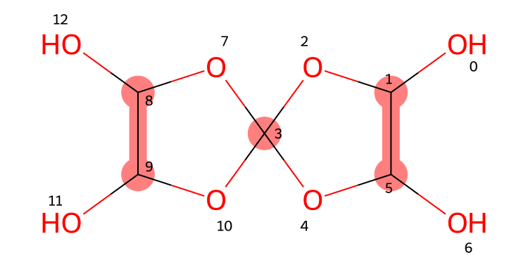
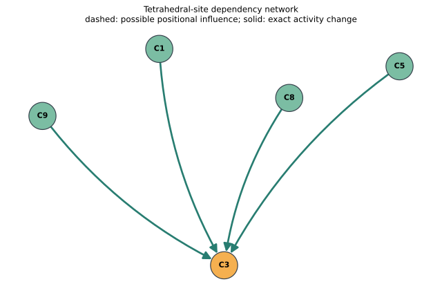

# Experiments — Stereoisomers

Two **separate, locally runnable Streamlit applications** built on
[the StereoMolGraph stereoisomer branch](https://github.com/maxim-papusha/StereoMolGraph/tree/stereoisomer):

## Application 1: Stereocenter detection and dependency graph

Run:

    streamlit run apps/stereocenter_detection.py

- Read tetrahedral candidates from an already prepared StereoMolGraph.
- Optionally build a StereoMolGraph from SMILES using the existing RDKit import adapter.
- Classify existing candidate sites using fast color refinement.
- Show the molecular skeleton with candidate atoms highlighted.
- Draw an **oriented dependency graph** among candidate tetrahedral sites.
- Optionally perform **exact, context-dependent activity analysis** by
  enumerating other local assignments and testing site-anchored stereo
  isomorphism (at most 5 sites/32 formal assignments).
- Export the report as JSON and the network as SVG.

**Dashed gray arrows** represent heuristic positional influence, not proven
stereochemical dependence. If exact analysis is selected, **solid green
arrows** indicate dependencies certified *under the present StereoMolGraph
graph-isomorphism model*. Neither graph proves physical ring feasibility.

## Application 2: Stereoisomer generation

Run:

    streamlit run apps/stereoisomer_generation.py

- Use *only the stereo descriptor sites already present*.
- Enumerate the local tetrahedral states supplied by
  StereoMolGraph descriptors; specified parities stay fixed.
- Remove duplicate completed graphs using the existing stereo-aware
  equality/isomorphism implementation.
- Compare the output count against RDKit as a reference; no claim of
  independent validation or equality of complete isomer **sets**.
- Export the configuration table and counts as JSON.

This is a complete baseline for **represented local descriptor assignments**,
not a complete stereochemical feasibility or stereocenter normalization
algorithm. No McKay-style automorphism pruning is used yet.

## Installation

Python 3.11+ and Git are required.

    git clone https://github.com/maxim-papusha/Experiments-Stereoisomers.git
    cd Experiments-Stereoisomers
    pip install -e ".[test]"

The installer retrieves StereoMolGraph from its experimental
`stereoisomer` branch. For reproducible publications pin the exact
StereoMolGraph commit and RDKit version.

## Scope

- Current experiments focus on **tetrahedral atom configurations**.
- Isotope-labelled inputs and inputs containing aromatic or multiple
  bonds are excluded (a stricter restriction than E/Z removal).
- Geometry-nomination is performed *before* the algorithm; neither
  application creates any stereo descriptor site.
- If a SMILES is used, the upstream StereoMolGraph importer may nominate
  many geometry-eligible but non-stereogenic candidates. For direct
  RDKit comparisons an optional checkbox filters those **existing**
  candidates to the RDKit potential tetrahedral site list. It never
  inserts missing sites.
- Molecular models and stereo-activity tests are graph-theoretical.
  3D ring realizability, interconversion barriers, and inactive-site
  normalization are not yet covered.

## Generated complex-molecule dependency examples

The following structures originate from the
[canonicalization experiment's 300 CIP Validation Suite SMILES](https://github.com/maxim-papusha/Experiments-CanonicalStereoMolGraph/blob/main/data/smiles.txt):

- **VS006:** bridged tetrahedral cage.
- **VS294:** cyclic oxygen-rich molecule with five candidate centers.
- **VS295:** related cyclic molecule with five candidate centers.

Generate both molecular drawings and dependency networks:

    python examples/generate_dependency_figures.py --output examples/figures

For an optional expensive exact dependency analysis:

    python examples/generate_dependency_figures.py --output examples/figures --exact

Expected files include
`VS294_molecule.svg`, `VS294_dependencies.svg`, and
`examples.json`. CI uploads these as artifacts, and the repository
keeps a static set of generated example graphs for inspection.

## Verified complex-molecule example: VS294

The exact analysis on **VS294** found five tetrahedral descriptor sites,
at atom indices 1, 3, 5, 8 and 9. Four are always active in the represented
configuration space. **Atom 3 is conditionally stereogenic**: changing
any one of the other four sites can change whether its two local
configurations are distinguishable in some fixed context.

This yields four verified directed dependency edges:

~~~mermaid
flowchart LR
  C1["C1 (always active)"] --> C3["C3 (conditionally active)"]
  C5["C5 (always active)"] --> C3
  C8["C8 (always active)"] --> C3
  C9["C9 (always active)"] --> C3
~~~

**Molecular structure with atom indices and highlighted candidate sites:**

**Computed directed stereochemical dependency network:**

- [View the VS294 dependency SVG](examples/figures/VS294_dependencies.svg)
- [View the VS295 dependency SVG](examples/figures/VS295_dependencies.svg)
- [View all example site classifications and exact witnesses](examples/figures/examples.json)

These are dependencies under the current **StereoMolGraph
site-anchored stereoisomorphism model**, not statements about the
existence of experimentally isolable stereoisomers.

The reference example VS006 shows an important counterpoint:
its fast positional influence heuristic predicts many edges,
but exact contextual activity finds **no** directed dependencies
for its four retained tetrahedral sites. This illustrates why
heuristic edges must not be used for completeness-critical pruning.

## Tests

    pytest -q

The GitHub Actions workflow independently tests the applications and
regenerates complex-molecule dependency figures. The applications can
be run separately and share only the underlying science/model layer.
